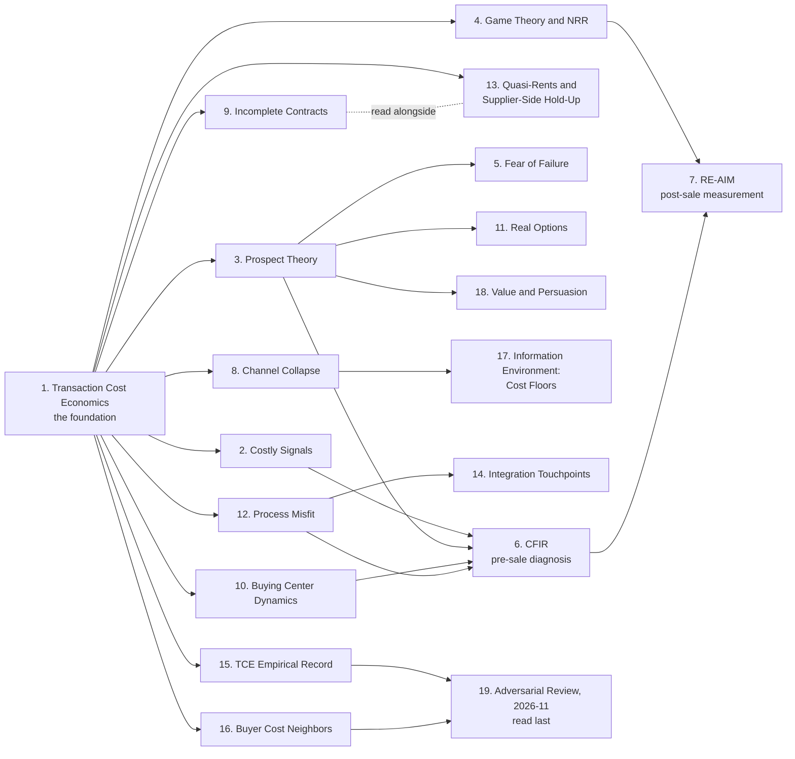

# Reading Guide

**How to navigate the research, in what order, for which audience.** This guide tells you where to start, what to read in what sequence, and what's safe to skip — given who you are and what you need.

The theoretical synthesis of these papers lives in the [Constitution](../01-foundation/00-tcg-constitution.md). This guide tells you which papers back the Constitution's claims and how to read them efficiently.

---

## How the research builds

The papers in this directory depend on each other in a specific order. Each arrow points from a file to one that should be read after it, so the foundation sits at the left and the files that extend it sit to its right. The numbered list below the diagram gives the reason for each arrow.

**Order of dependency:**

1. **[Transaction Cost Economics](./transaction-cost-economics.md)** — Start here. Coase asks whether to use the market, Dahlman names its three costs (Axiom I), and Williamson splits them into the ex ante costs today's investment pays (Axiom II) and the ex post costs specificity creates (Axiom III).
2. **[Costly Signals](./costly-signals.md)** — Builds on TCE: how friction resolves information asymmetry.
3. **[Prospect Theory](./prospect-theory.md)** — Explains *why* buyers fear change at the neurobiological level, and why a possible loss outweighs a matching gain.
4. **[Game Theory and NRR](./game-theory-and-nrr.md)** — Shows how incentives must be structured to sustain cooperation across the repeated game.
5. **[Fear of Failure](./fear-of-failure.md)** — Empirical evidence: Standish CHAOS, Gartner regret data, the JOLT Effect.
6. **[CFIR](./cfir.md)** — Pre-sale diagnostic methodology.
7. **[RE-AIM](./re-aim-framework.md)** — Post-sale measurement methodology.

Plus the channel-level layer:

8. **[Channel Collapse](./channel-collapse.md)** — Jevons' Paradox applied to outbound. Governance solutions for the channel-level externality problem.

Plus three sources added under the Constitution's earlier numbering, before 4.0. Each deepens an axiom that already existed, so read them after the paper they extend rather than in sequence:

9. **[Incomplete Contracts](./incomplete-contracts.md)** — Read after Transaction Cost Economics. Williamson explains why asset specificity creates exposure. Grossman-Hart-Moore explain what determines the outcome once exposure exists, which is the allocation of residual control rights. This is the theory beneath the MIP. Its 2026-09 extension carries the incomplete-contracting and front-end-loading evidence behind the allocation clause, now Axiom III's: allocation is settled before the investment is sunk, while the adaptation follows. Constitution 3.0 changed *paid* to *allocated* when the clause sat in Axiom II.
10. **[Buying Center Dynamics](./buying-center-dynamics.md)** — Read before CFIR. Establishes that the buyer is a coalition rather than an agent, which is the premise CFIR's Inner Setting analysis depends on. Supplies the structure of $F_{consensus}$.
11. **[Real Options](./real-options.md)** — Read after Prospect Theory. Loss aversion explains why the buyer fears the downside. Real options explains why waiting is a rationally priced alternative rather than mere inertia, and why staged commitment is the counter.

Plus the implementation layer:

12. **[Process Misfit](./process-misfit.md)** — Read after Transaction Cost Economics and before CFIR. Williamson establishes that asset specificity creates exposure. The misfit literature says what that specificity is made of in a software deal, and names the six domains a seller can inspect before the investment is sunk. Its four responses to misfit are the buyer's adaptation work, which Axiom II counts as investment against the policing cost, and its distance from the reference workflow is what Axiom III reads as specific.

Plus the seller-side layer:

13. **[Appropriable Quasi-Rents and Supplier-Side Hold-Up](./klein-crawford-alchian.md)** — Read after Transaction Cost Economics and alongside Incomplete Contracts. Williamson says specificity creates exposure. Klein, Crawford and Alchian name the quantity at stake and establish that it belongs to whichever party sank the investment, which in a forward-deployed motion is the seller. Backs [04-seller-surplus-model.md](../01-foundation/04-seller-surplus-model.md).

Plus the workflow layer:

14. **[Integration Touchpoints](./integration-touchpoints.md)** — Read after Process Misfit. Misfit says what specificity is made of. The touchpoint taxonomy says where a product meets the buyer's system of record, in five types that hold in any vertical. It is how the step library in [08-from-axioms-to-instruments.md](../01-foundation/08-from-axioms-to-instruments.md) matches steps across workflows, and how the decision roles around a workflow are predicted before a buyer is met. The one practitioner source in this directory, recorded as such.

Plus the critiques:

15. **[The TCE Empirical Record and Its Critiques](./tce-empirical-record.md)** — Read after Transaction Cost Economics and before extending Axiom III. Where the empirical record supports specificity and fails uncertainty, why Ghoshal and Moran say governing for opportunism is self-fulfilling, why List's field experiments count against borrowing loss aversion, and the software-economics account of subscription that retired the claim that subscription won for governance reasons. This file records where the framework is weakest, on purpose.

Plus the Constitution 5.0 layer, added 2026-11 as the evidence for the 5.0 proposal. Each answers a neighbor or an objection, so read it after the file it extends:

16. **[Buyer Cost Neighbors](./buyer-cost-neighbors.md)** — Read after Transaction Cost Economics. What Gartner, Moore, MEDDICC, value selling, Skok and Janz, total cost of ownership, Cannon and Homburg and Hockenmaier each claim, where TCG concedes, and the one prediction that separates them. Ends with what is original and what is synthesis.
17. **[The Information Environment: Cost Floors](./information-environment.md)** — Read after Channel Collapse. The part of each cost set outside the deal, which no seller lowers within one deal at a return the deal repays, and what does lower it. Backs the cost floor corollary.
18. **[Value and Persuasion](./value-and-persuasion.md)** — Read after Prospect Theory. The split between realizable, recognized and realized value behind the second standing assumption, and the constructed-preferences objection that survives it.

Plus the adversarial layer:

19. **[Adversarial Review, 2026-11](./adversarial-review-2026-11.md)** — Read last. An external review set out to break seven claims. Records what the Constitution already answered, the five objections that survive, about thirty uncited sources, and which of the review's own figures are not fit to cite. Opened open questions 37 to 43.

---

## Which sources back which axiom

Each file's `operationalizes` field carries the same mapping. The Constitution's Related section lists it too.

| Axiom | The decision | Sources |
|---|---|---|
| **I. Composition** | Should I use the market? | [Transaction Cost Economics](./transaction-cost-economics.md) for Coase's question and Dahlman's three costs, [Buying Center Dynamics](./buying-center-dynamics.md), [Channel Collapse](./channel-collapse.md), [Fear of Failure](./fear-of-failure.md), [Integration Touchpoints](./integration-touchpoints.md), [Buyer Cost Neighbors](./buyer-cost-neighbors.md) for the non-compensatory rule against its neighbors, [Adversarial Review, 2026-11](./adversarial-review-2026-11.md) |
| **II. Investment** | What will it cost me today? | [Transaction Cost Economics](./transaction-cost-economics.md) for Williamson's ex ante costs, [Integration Touchpoints](./integration-touchpoints.md) for the adaptation each touchpoint demands, [Process Misfit](./process-misfit.md) for the buyer's four responses to misfit, [The Information Environment](./information-environment.md) for the cost floor corollary, [Value and Persuasion](./value-and-persuasion.md) for adoption effort priced as buyer investment, [Adversarial Review, 2026-11](./adversarial-review-2026-11.md) |
| **III. Future Cost** | What might it cost me later? | Specificity and governance: [Transaction Cost Economics](./transaction-cost-economics.md) for Williamson's ex post costs, [Klein, Crawford and Alchian](./klein-crawford-alchian.md), [Incomplete Contracts](./incomplete-contracts.md), [Process Misfit](./process-misfit.md), [Game Theory and NRR](./game-theory-and-nrr.md), [Real Options](./real-options.md), [Integration Touchpoints](./integration-touchpoints.md). Gaps and verification: [Costly Signals](./costly-signals.md), [Prospect Theory](./prospect-theory.md), [Fear of Failure](./fear-of-failure.md), [Buying Center Dynamics](./buying-center-dynamics.md), [Channel Collapse](./channel-collapse.md), [CFIR](./cfir.md), [RE-AIM](./re-aim-framework.md). The critique: [The TCE Empirical Record](./tce-empirical-record.md). The value assumption: [Value and Persuasion](./value-and-persuasion.md), [Adversarial Review, 2026-11](./adversarial-review-2026-11.md) |

---

## What you won't find here

This is a citation index, not a theoretical synthesis. The synthesis lives elsewhere:

- **Three axioms and their derivations:** [Constitution](../01-foundation/00-tcg-constitution.md), Parts I and II.
- **The two conditions and the failure modes table:** Constitution Part III. The per-axiom figures are in Part I, generated from [`models/`](../../models/).
- **Operational tools** (rubric, artifacts): [`practice/`](../../practice/).
